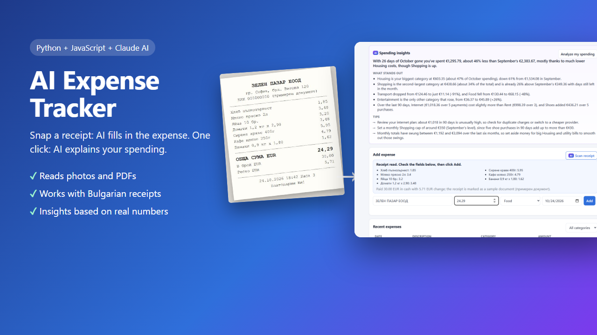
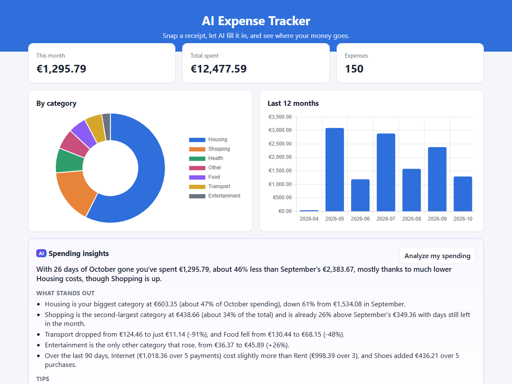

# AI Expense Tracker

A full-stack expense tracker with two AI features powered by Claude:

1. **Scan a receipt.** Upload a photo or PDF, and AI fills in the shop, total, date and category. You check it and click Add.
2. **Spending insights.** One click turns your numbers into a plain-language summary, the biggest changes from last month, and practical tips.



## AI features

### Receipt scanning (vision + Structured Outputs)
- Reads **JPG, PNG, WebP, GIF photos and PDF** invoices
- Works with **any language**. Tested with a Bulgarian receipt that uses comma decimals.
- Returns the shop, date, total, currency, category and every line item, validated against a **JSON schema**. The category always comes from the app's own list.
- **Never guesses.** Unreadable values come back empty, and a note explains anything unclear.
- **Human in the loop.** The AI only fills in the form; nothing is saved until you click Add.
- Warns when a receipt isn't in EUR

Result on [the sample receipt](examples/receipt.jpg): shop, date, total (€24.29), category and all 7 line items read correctly, in about 7 seconds.

### Spending insights
- The server calculates totals with SQL: this month vs last month by category, monthly totals for 6 months, and the top expenses in the last 90 days.
- **Only these totals are sent to the AI**, never your individual expenses.
- The AI writes a summary, 3–5 insights with amounts and percentages, and 2–3 tips.
- Tested on demo data: every amount in the insights matched the database.



## Also included (from the base dashboard)
- Add, edit, delete and filter expenses (REST API + `fetch`, no page reloads)
- Dashboard cards and Chart.js charts by category and month
- Server-side validation, parameterized SQL and XSS-safe rendering
- Responsive layout

## Tech stack

| Layer | Technology |
|---|---|
| Frontend | HTML, CSS, vanilla JavaScript, Chart.js |
| Backend | Python, Flask (REST API) |
| Database | SQLite |
| AI | Claude API: vision, PDF input, Structured Outputs (JSON schema) |
| Tests | `unittest` + Flask test client, with a fake AI client |

## Setup

```bash
pip install -r requirements.txt
cp .env.example .env     # Windows: copy .env.example .env
# add your API key from https://console.anthropic.com to .env

python app.py --demo     # adds 150 sample expenses, then starts the server
```

Open http://localhost:5000. Without an API key the app still works; only the AI buttons show a message.

## API

| Method | Endpoint | Description |
|---|---|---|
| GET / POST | `/api/expenses` | List or create expenses |
| PUT / DELETE | `/api/expenses/<id>` | Update or delete an expense |
| GET | `/api/stats` | Totals and chart data |
| POST | `/api/receipts/scan` | **AI**: read a receipt (multipart field `receipt`) and return suggested fields |
| POST | `/api/insights` | **AI**: plain-language spending insights |

## Cost

Each receipt scan and each insights request costs about $0.01–0.02 with the default model `claude-opus-5-5`.

## Tests

```bash
python -m unittest test_app.py test_ai.py
```

13 tests, all offline: the original API tests, plus receipt scanning (image, PDF, wrong file type, "not a receipt", invalid dates, nothing saved without confirmation) and insights (only totals are sent).
